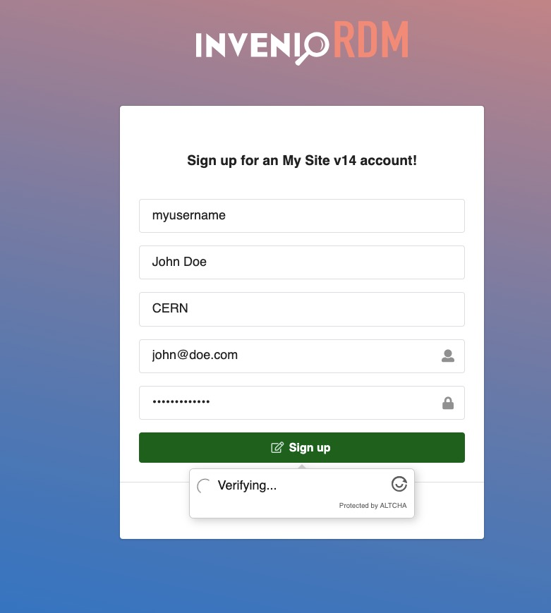
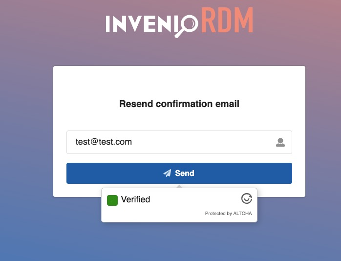

# Captcha

A captcha protects your instance against bots and automated spam. Without it, bots can create thousands of fake accounts, fill your repository with spam records, and potentially send emails from your server.

InvenioRDM uses [ALTCHA](https://altcha.org), a privacy-friendly captcha. It was added in **InvenioRDM v15** and replaces the previously existing Google reCAPTCHA.

## How it works

ALTCHA is a *proof-of-work* captcha:

1. The user's browser asks your server for a small puzzle.
2. The browser solves the puzzle. This takes a moment and the user does not need to do anything.
3. The solution is sent with the form, and your server checks it.

Real users barely notice it. A bot that sends thousands of requests has to solve thousands of puzzles, which makes abuse slow and expensive.

**Why ALTCHA?**

- **Self-hosted**: no third-party service is contacted, and no data leaves your server.
- **Privacy-friendly**: no tracking and no cookies.
- **Accessible**: users do not have to click on images or read distorted text.

{width="300", : .screenshot}

## Where it is used

When enabled, ALTCHA protects these forms:

- Registration (sign up)
- Forgot password
- Resend confirmation email

## Enable ALTCHA

!!! info "Disabled by default"
    ALTCHA is **disabled by default**. Enable it in your `invenio.cfg`:

```python
ACCOUNTS_ALTCHA_ENABLED = True
ACCOUNTS_ALTCHA_HMAC_KEY = "<randomly-generated-key>"
# Rate limit configuration
RATELIMIT_ENABLED = True  # required: used challenges are stored by the rate limiter (default)
RATELIMIT_STORAGE_URI = "redis://localhost:6379/3"  # shared storage, so a challenge is used once across all processes
```

Then rebuild your assets:

```bash
$ cd my-site
$ invenio-cli assets build
```

!!! warning "Rate limiting must be enabled"
    A solved challenge can only be used once. Used challenges are recorded in the rate limiter storage, so ALTCHA requires [rate limiting](./rate-limiting.md) to be enabled (`RATELIMIT_ENABLED = True`, the default). With `RATELIMIT_ENABLED = False`, there is no replay protection: a solved challenge can be reused until it expires (`ACCOUNTS_ALTCHA_EXPIRES`), and a warning is logged at startup.

!!! warning "Use shared rate limit storage in production"
    To enforce single use across all your web processes, set `RATELIMIT_STORAGE_URI` to a shared storage such as Redis. With the default `memory://` storage, the protection works per process only. See [Rate limiting](./rate-limiting.md).

## Configuration

| Setting | Default | Description |
|---|---|---|
| `ACCOUNTS_ALTCHA_ENABLED` | `False` | Turns ALTCHA on. |
| `ACCOUNTS_ALTCHA_HMAC_KEY` | `None` | Secret used to sign challenges. If `None`, a key derived from `SECRET_KEY` is used. |
| `ACCOUNTS_ALTCHA_ALGORITHM` | `"PBKDF2/SHA-256"` | Algorithm used for the puzzle. |
| `ACCOUNTS_ALTCHA_COST` | `5000` | Difficulty of the puzzle (number of iterations). Higher means harder for bots, but slower for users. |
| `ACCOUNTS_ALTCHA_EXPIRES` | `timedelta(minutes=10)` | How long a challenge stays valid. |
| `ACCOUNTS_ALTCHA_WIDGET_ATTRS` | `{"display": "floating", "auto": "onsubmit"}` | HTML attributes of the widget. |

### Widget appearance

By default the widget is *floating*: it is hidden until the user submits the form, then it appears next to the button while the puzzle is solved.

To show the standard checkbox instead, use an empty dictionary:

```python
ACCOUNTS_ALTCHA_WIDGET_ATTRS = {}
```

{width="300", : .screenshot}

You can also pass other [widget attributes](https://altcha.org/docs/v2/widget-integration/), for example a theme:

```python
ACCOUNTS_ALTCHA_WIDGET_ATTRS = {"display": "floating", "auto": "onsubmit", "theme": "aqua"}
```

### Tuning the difficulty

If you still see a lot of spam, increase `ACCOUNTS_ALTCHA_COST`. If users on slow devices complain, decrease it. Change it in small steps and test on a phone.

```python
ACCOUNTS_ALTCHA_COST = 10000
```

## Customized templates

If you [override the templates](./look-and-feel/templates.md) of the registration, forgot password or resend confirmation pages, your version must:

1. Render the field with `{{ form.altcha() }}`.
2. Include the `invenio-accounts-altcha` JavaScript and CSS bundles.

Copy the current template from `invenio_accounts` as a starting point, for example `invenio_accounts/register_user.html`. If you do not do this, users will not see the widget and the form will be rejected.

## Upgrading from reCAPTCHA

Before v15, InvenioRDM used Google reCAPTCHA (`RECAPTCHA_PUBLIC_KEY` and `RECAPTCHA_PRIVATE_KEY`).

- If these keys are still set, ALTCHA is **enabled automatically** and a deprecation warning is logged. Nothing breaks.
- To remove the warning, delete both `RECAPTCHA_*` keys and set `ACCOUNTS_ALTCHA_ENABLED = True` and the value of `ACCOUNTS_ALTCHA_HMAC_KEY`.
- Support for the `RECAPTCHA_*` keys will be removed in a future release.

If you customized the account templates, follow the [v15 upgrade guide](../../releases/v15/upgrade-v15.0.md#switch-from-recaptcha-to-altcha).

## Good to know

- A captcha is only one layer. Combine it with [rate limiting](./rate-limiting.md), email confirmation and the other measures in the [hardening checklist](../ops/hardening.md).
- A user that cannot pass the captcha usually has JavaScript disabled or a very old browser.
