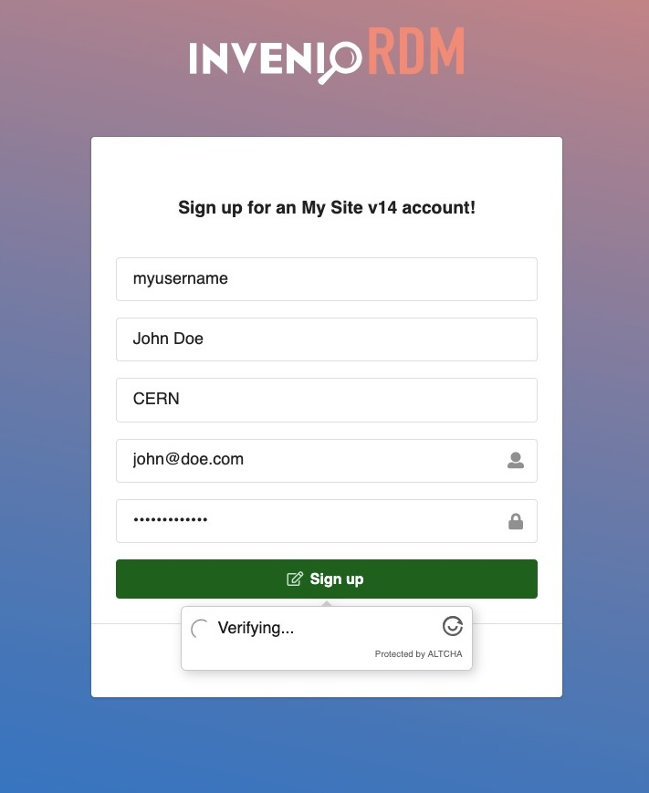

# InvenioRDM v15.0

_YYYY-MM-DD_

DRAFT

## Try it

- [Demo site](https://inveniordm.web.cern.ch)
- [Install from scratch instructions](../../install/index.md)

## What's new?

### Privacy-friendly captcha with ALTCHA

InvenioRDM now protects the registration, forgot password and resend confirmation forms with [ALTCHA](https://altcha.org), a privacy-friendly captcha.

ALTCHA replaces Google reCAPTCHA:

- **Self-hosted**: puzzles are created and checked by your own server. No third-party service is contacted.
- **No tracking, no cookies**: your users' data stays with you, which makes GDPR compliance simpler.
- **No keys to manage**: no external account or API keys are needed.
- **Easier for users**: no images to click. The browser solves a small puzzle in the background.

{width="300", : .screenshot}

See the [Captcha documentation](../../operate/customize/captcha.md) for more information.

## Deprecations

- The reCAPTCHA settings `RECAPTCHA_PUBLIC_KEY` and `RECAPTCHA_PRIVATE_KEY` are deprecated. If they are set, ALTCHA is enabled automatically and a warning is logged. Support for them will be removed in a future release. See the [upgrade guide](./upgrade-v15.0.md#switch-from-recaptcha-to-altcha).

## Breaking changes

- Google reCAPTCHA is no longer supported and has been replaced by ALTCHA. Your configuration keeps working, but **customized templates** for the registration, forgot password or resend confirmation pages must be updated, otherwise these forms are rejected. See the [upgrade guide](./upgrade-v15.0.md#switch-from-recaptcha-to-altcha).

## Upgrading to v15

Detailed instructions on how to upgrade from v14 to v15 are in the [v15 upgrade guide](./upgrade-v15.0.md).

## Questions?

If you have questions related to these release notes, don't hesitate to jump on [Discord](https://discord.gg/8qatqBC) and ask us!
